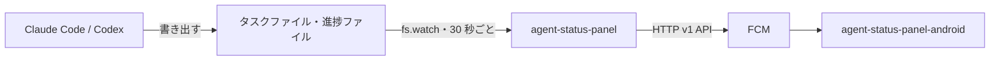

# agent-status-panel

Mac mini で常駐し、実行中の Claude Code と Codex のタスクの進捗を、[FCM](https://firebase.google.com/docs/cloud-messaging) でスマートフォンへ送るスクリプトです。受け取り側のアプリは [agent-status-panel-android](https://github.com/andoshin11/agent-status-panel-android) です。



> [!WARNING]
> `~/.claude/tasks` などの形式は Claude Code の内部仕様で、更新で変わる可能性があります。

## 必要なもの

- macOS と Node.js 24 以上（実行時の依存パッケージはありません）
- FCM を有効にした Firebase プロジェクトとサービスアカウントの鍵
- 受け取り側アプリの FCM 登録トークン
- iPhone に通知するなら、Apple Developer Program のアカウント
- [Milestone](https://github.com/andoshin11/orca-milestone) プラグイン。起動した Claude Code にタスクを書くよう指示し、Codex に進捗を記録するツールを渡します。これがなければ、別の方法で同じ設定を入れてください。

## 設定

Firebase コンソールの **プロジェクトの設定 → サービス アカウント** で鍵を作り、リポジトリの外に置きます。鍵と設定ファイルは、所有者だけが読める権限にしてください。権限が広いと起動しません。

```sh
mkdir -p ~/.config/agent-status-panel
mv ~/Downloads/<鍵のファイル>.json ~/.config/agent-status-panel/service-account.json
chmod 600 ~/.config/agent-status-panel/service-account.json
touch ~/.config/agent-status-panel/config.json
chmod 600 ~/.config/agent-status-panel/config.json
```

`~/.config/agent-status-panel/config.json`:

```json
{
  "serviceAccountFile": "/Users/<ユーザー名>/.config/agent-status-panel/service-account.json",
  "deviceTokens": ["<アプリの FCM 登録トークン>"]
}
```

| 項目 | 必須 | 既定値 | 内容 |
|---|---|---|---|
| `serviceAccountFile` | はい | | サービスアカウントの鍵の絶対パス |
| `deviceTokens` | はい | | 送信先の FCM 登録トークン |
| `sendText` | いいえ | `true` | `false` にすると、ゴール・ステップ・タスク一覧・ワークスペース名を送らず、件数と状態だけを送ります |
| `staleMinutes` | いいえ | `120` | この時間タスクが変わらないセッションは `live` を `0` にして送ります。ウィジェットでは下に並びます |
| `httpPort` | いいえ | | 指定すると、セッションの一覧をこのポートで返します。`127.0.0.1` だけで待ち受けます。[iPhone から読む](#iphone-から読む)を参照 |
| `apns` | いいえ | | 指定すると、エージェントが操作を待っているときに iPhone へ通知します。[iPhone に通知する](#iphone-に通知する)を参照 |
| `allowedLogin` | いいえ | | 指定すると、この Tailscale のログイン名の人だけが、エージェントの提案をボタンで実行できます。なければ実行できません。[次にやることをボタンで頼む](#次にやることをボタンで頼む)を参照 |

## 使い方

```sh
node bin/agent-status-panel.mjs dry-run    # 今送る内容を表示する（設定不要、何も送らない）
node bin/agent-status-panel.mjs send-test  # テストメッセージを送る
node bin/agent-status-panel.mjs send-test-ios  # 登録済みの iPhone にテスト通知を送る
node bin/agent-status-panel.mjs install    # launchd に登録して常駐させる
node bin/agent-status-panel.mjs uninstall  # 登録を解除する
```

ログは `~/Library/Logs/agent-status-panel.log` に出ます。launchd には今の Node.js の絶対パスを登録するので、Node.js を入れ替えたら `install` をやり直してください。

## 送る内容

メッセージは Google のサーバーを経由します。送るのは次の項目だけで、値はすべて文字列です。FCM の 4 KB の制限があるので、タスクが多いと一覧の一部だけを送ります。

| 項目 | 内容 |
|---|---|
| `v` | 形式のバージョン（今は `1`） |
| `id` | セッションの識別子（セッション ID のハッシュ） |
| `state` | `active`（作業中）、`finished`（全タスク完了）、`ended`（セッションの終了など） |
| `live` | `1` は今動いているセッション、`0` はしばらく更新がないセッションです |
| `attention` | エージェントが操作を待っている理由。`waiting`（入力待ち）、`blocked`（ブロック中）、`permission`（許可待ち）。なければ空です |
| `at` | 送信時刻（Unix ミリ秒）。FCM は順序を保証しないので、これより古いメッセージはアプリ側で捨てます |
| `agent` | `claude` または `codex` |
| `workspace` | 作業ディレクトリの名前（パスは送りません） |
| `goal` | エージェントがタスクに書いたゴール（最大 120 文字） |
| `step` | 実行中のステップ（最大 120 文字） |
| `tasks` | タスク一覧を `[状態, 件名]` の JSON 文字列にしたもの。状態は `c`（完了）、`i`（実行中）、`p`（未着手）。件名は最大 60 文字で、2400 バイトに収まれば全件、収まらなければ実行中のタスクの周辺を送ります |
| `done` / `total` | 完了数と全体の数（`tasks` を絞っても全体の数です） |

`state` が `ended` のメッセージは、`v`、`id`、`state`、`at` だけです。

`state` が `attention` のメッセージは、エージェントが操作を待ち始めたことを伝えて、スマホに通知を出します。項目は `v`、`id`、`state`、`at`、`reason`（`attention` と同じ値）、`workspace` だけです。操作を待たなくなると、同じ `id` の `ended` を送ります。エージェントの状態は `orca worktree ps` から 15 秒ごとに読むので、Orca の外で起動したエージェントは対象外です。プロンプトや質問の本文は送りません。

動いているセッションのうち、タスクのあるものをすべて送ります。

- **送らないもの:** ユーザーのプロンプト、タスクの説明、作業ディレクトリのパス、セッション ID。ゴールが書かれていなくても、プロンプトで補いません。
- **送るタイミング:** 内容が変わったときだけです。短時間の変更は 2 秒待ってまとめます。送信に失敗したら、30 秒後に再試行します。
- **再起動:** 送信済みの内容を `~/.local/state/agent-status-panel/state.json` に保存します。再起動しても同じ内容を送らず、停止中に終わったセッションは終了を送ります。
- **ゴール・ステップ・タスクの件名:** エージェントが書いたものなので、社内の名称などが含まれる可能性があります。外に出したくなければ `sendText` を `false` にしてください。

## iPhone から読む

iOS のウィジェットはプッシュでデータを受け取れないので、[agent-status-panel-ios](https://github.com/andoshin11/agent-status-panel-ios) は Mac mini から一覧を取りに来ます。`config.json` に `httpPort` を足して `install` をやり直し、[Tailscale](https://tailscale.com) で tailnet の中にだけ公開します。

```sh
tailscale serve --bg 8787   # httpPort が 8787 のとき
tailscale serve status      # iPhone から読む URL（https://<マシン名>.<tailnet>.ts.net/）を確かめる
```

アプリに設定する URL は `https://<マシン名>.<tailnet>.ts.net/status.json` です。tailnet に参加している端末ならどれでも読めるので、ほかの人と共有している tailnet では使わないでください。`tailscale funnel` を使うとインターネットに公開されてしまうので、使わないでください。

`GET /status.json` は次の JSON を返します。`sessions` の各要素は FCM のメッセージと同じ形式（`at` を除く）で、セッションが現れた順に並びます。デーモンを起動して最初に読み終わるまでは `503` を返します。

```json
{ "v": "1", "at": "1793923200000", "sessions": [{ "id": "…", "state": "active", "live": "1", "done": "1", "total": "2", "…": "…" }] }
```

## 次にやることをボタンで頼む

エージェントは作業を終えると、回答の最後に次の候補を書きます（[Milestone](https://github.com/andoshin11/orca-milestone) が起動時に指示します）。iOS アプリはこれをボタンで表示し、押すとその依頼がエージェントのターミナルに送られます。

````
```next
[{"label":"PR を作る","prompt":"この変更で PR を作ってください"}]
```
````

候補は 3 つまで、`label` は 30 文字まで、`prompt` は 300 文字までです。形式が崩れたブロックは無視します。そのカードを勧める理由を `reason` に書くと（省略可、80 文字まで）、カードに表示します。

`GET /status.json` のセッションには次の項目が増えます。FCM と APNs では送りません。

| 項目 | 内容 |
|---|---|
| `offer` | 今の提案の ID。ターンごとに変わります。提案がなければ項目がありません |
| `suggestions` | ボタンの文字の JSON 配列（文字列） |
| `details` | ボタンの説明の JSON 配列（文字列）。順番は `suggestions` と同じです。提案は送られる依頼文、質問は選択肢の説明です |
| `reasons` | カードを勧める理由の JSON 配列（文字列）。順番は `suggestions` と同じで、理由のないカードは空文字列です。どのカードにも理由がなければ項目がありません |
| `question` | カードの上に出す説明。質問は質問文、許可は実行内容、提案は直前の回答の冒頭（160 文字まで）と、任意であることの一文です |

| `links` | 開ける PR の JSON 配列（文字列）。`[{"title":"PR #12 · repo","url":"…"}]`。エージェントの最新の回答にある URL と、Orca がワークスペースに紐づけた開いている PR です |

ボタンを押すと、アプリが `POST /next` に `{"offer":"…","index":0}` を送ります。

| 応答 | 意味 |
|---|---|
| `204` | エージェントに送りました |
| `409` | その提案はもう使えません（次のターンに進んだ、押し済みなど） |
| `403` | `allowedLogin` の人ではありません |
| `428` | 危険なコマンドの許可で、`"confirmed":true` がありません |
| `423` | Codex の入力欄に書きかけの文字があり、送るとつながってしまいます |
| `502` | Orca への送信に失敗しました |

Claude Code の入力欄に書きかけの文字があるときは、送る前に Ctrl+S で退避します。依頼文だけが送られ、書きかけの文字は入力欄に戻ります。Codex には退避の機能がないので、入力欄に文字があれば依頼文は送りません（許可のボタンはメニューへのキー操作なので、書きかけの文字があっても押せます）。

Claude Code が入力欄に薄く出す次のプロンプトの候補（Prompt suggestions）も、ボタンとして足します。対話モードの候補はフックやファイルでは受け取れないので、Orca が残す端末の出力（`terminal-history/<pty>/output.log`）から、入力欄の行に今表示されているものを読みます。Claude Code の描画が変わると読めなくなりますが、その場合はこのボタンが出ないだけです。

スマホから送れるのは ID と番号だけで、依頼文は押された時点の回答から読み直します。任意の文章は送れず、古い画面のボタンは何も起こしません。読み取りと違い、`tailscale serve` が付ける `Tailscale-User-Login` ヘッダーで本人を確かめます。ログイン名は `tailscale status --json` の `User` で確かめられます。

Claude Code が `AskUserQuestion` で質問しているときは、選択肢が同じ形のボタンになります。押すと、その番号のキーをメニューに送ります。質問文と選択肢はトランスクリプトから読み、FCM と APNs では送りません。1 問だけの単一選択は押すとすぐ答えます。複数の質問や複数選択は `status.json` の `questions`（`[{"question","multiSelect","options":[{"label","detail"}]}]` の JSON 文字列）でフォームになり、アプリは `POST /next` に `{"offer":"…","answers":[[0],[1,2]]}` を送ります。メニューの確認画面まで進んだことを確かめてから送信します。

Claude Code がツールの許可を待っているときは、「許可」（今回だけ）と「拒否」のボタンになります。呼び出しは transcript の未回答のものから読みます。1 つのターンで複数の呼び出しを出して許可を待っている間は、まだ transcript に書かれていないため、シェルのコマンドに限り、Orca が返すコマンドと画面のメニューが一致するときにボタンを出します。メニューの番号はツールによって変わるので、押す直前に画面を読み、そのコマンドのメニューに `1. Yes` があるときだけ `1` を押します。拒否は常に Esc です。`rm`、`sudo`、`git push --force` など危険なコマンドは `status.json` の `dangerous` が `1` になり、アプリの確認を経た `{"offer":"…","index":0,"confirmed":true}` でなければ実行しません。判定は簡単なパターンの照合なので、すべての危険な操作を見分けられるわけではありません。

許可のカードの文面（`question`）は、`［書き換える］Bash を許可しますか？ <コマンド>` のように、呼び出しの種類から始まります。種類は `［読むだけ］`、`［書き換える］`、`［外に出る］`（`git push`、`gh pr create`、データを送る `curl`、`kubectl`、`aws`、DB クライアント、送信する MCP ツールなど、この Mac の外に届くもの）と、危険なコマンドの `［危険］` です。シェルのコマンドは、すべての部分が読むだけと分かるときだけ `［読むだけ］` になり、知らないコマンドは `［書き換える］` とみなします。コマンドを実行する場所がワークスペースの直下でないときは、2 行目に `場所: apps/web`（ワークスペースの中）や `場所: ~/dev/Juiz`（外）を添えます。場所は transcript に残るシェルの作業ディレクトリと、コマンドの先頭の `cd <dir> &&` から決めます。アプリには文面のまま表示されるので、アプリの更新は要りません。

対象は、Orca で動いていて、待機中（`done`）か質問中のメインのエージェントが 1 つだけのワークスペースです。複数いるワークスペースはどのエージェント宛てか決められないので、ボタンを出しません。

Orca は、Claude Code が裏で動かしているシェル（`run_in_background`）があると、ターンを終えて入力を待っていても「作業中」（`working`）と返します。そのため、Orca が作業中と返す Claude のエージェントは、transcript の末尾を読みます。最後のターンの後に Claude Code が書く `turn_duration` があり、その後にプロンプトやツールの結果がなければ、待機中（`done`）として扱います。こうして、裏でシェルが動いているセッションにも提案のボタンが出ます。transcript を読めないときや、同じフォルダで Claude が複数動いているときは、Orca の返すとおりです。

## iPhone に通知する

Codex が許可を待っているときは、シェルのコマンドとファイルの編集に限り、「許可」（今回だけ）と「中止」のボタンになります。画面に `1. Yes, proceed (y)` のメニューが出ているときだけ `1` を押します。「今後は聞かない」の選択肢は押しません。Codex は Esc でターン全体を止めるので、もう一方は「拒否」ではなく「中止」です。危険なコマンドの確認は Claude Code と同じです。ほかのツールや、フォルダを信頼するかの確認画面は、ボタンになりません。

エージェントが許可や入力を待ち始めたら、iOS アプリに APNs で通知します。待つのをやめたら、表示中の通知を消すためのサイレントプッシュを送ります。進捗は送りません（ウィジェットとアプリが読みに来ます）。[iPhone から読む](#iphone-から読む)の設定が前提です。

1. [Apple Developer](https://developer.apple.com/account/resources/authkeys/add) で APNs を有効にしたキーを作り、`.p8` をダウンロードします。Xcode から直接入れるアプリは Sandbox を使うので、Environment は Sandbox か Sandbox & Production にします。
2. 鍵を設定ディレクトリに移し、所有者だけが読める権限にします。

   ```sh
   mv ~/Downloads/AuthKey_<キー ID>.p8 ~/.config/agent-status-panel/
   chmod 600 ~/.config/agent-status-panel/AuthKey_<キー ID>.p8
   ```

3. `config.json` に `apns` を足して `install` をやり直します。

   ```json
   "apns": {
     "keyFile": "/Users/<ユーザー名>/.config/agent-status-panel/AuthKey_<キー ID>.p8",
     "keyId": "<キー ID>",
     "teamId": "<チーム ID>",
     "topic": "<アプリの Bundle ID>"
   }
   ```

iOS アプリは起動するたびに `POST /apns/devices` でデバイストークンを登録します。登録先は `~/.local/state/agent-status-panel/apns-devices.json` です。アプリを消すなどして APNs が受け付けなくなったトークンは、自動で外します。

```json
{ "token": "<16 進のデバイストークン>", "environment": "development" }
```

`environment` は、Xcode から入れたアプリなら `development`、TestFlight や App Store から入れたアプリなら `production` です。

## 開発

```sh
npm test
```

`src/claude-sessions.mjs` は [orca-milestone](https://github.com/andoshin11/orca-milestone) から、プロンプトを読む部分を除いて持ってきたものです。

## ライセンス

MIT
