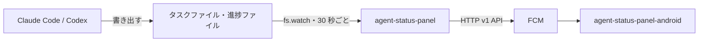

# agent-status-panel

Mac mini で常駐し、実行中の Claude Code と Codex のタスクの進捗を、[FCM](https://firebase.google.com/docs/cloud-messaging) でスマートフォンへ送るスクリプトです。受け取り側のアプリは [agent-status-panel-android](https://github.com/andoshin11/agent-status-panel-android) です。



> [!WARNING]
> `~/.claude/tasks` などの形式は Claude Code の内部仕様で、更新で変わる可能性があります。

## 必要なもの

- macOS と Node.js 24 以上（実行時の依存パッケージはありません）
- FCM を有効にした Firebase プロジェクトとサービスアカウントの鍵
- 受け取り側アプリの FCM 登録トークン
- [Milestone](https://github.com/andoshin11/orca-milestone) プラグイン。起動した Claude Code にタスクを書くよう指示し、Codex に進捗を記録するツールを渡します。これがなければ、別の方法で同じ設定を入れてください。

## 設定

Firebase コンソールの **プロジェクトの設定 → サービス アカウント** で鍵を作り、リポジトリの外に置きます。鍵と設定ファイルは、所有者だけが読める権限にしてください。権限が広いと起動しません。

```sh
mkdir -p ~/.config/agent-status-panel
mv ~/Downloads/<鍵のファイル>.json ~/.config/agent-status-panel/service-account.json
chmod 600 ~/.config/agent-status-panel/service-account.json
touch ~/.config/agent-status-panel/config.json
chmod 600 ~/.config/agent-status-panel/config.json
```

`~/.config/agent-status-panel/config.json`:

```json
{
  "serviceAccountFile": "/Users/<ユーザー名>/.config/agent-status-panel/service-account.json",
  "deviceTokens": ["<アプリの FCM 登録トークン>"]
}
```

| 項目 | 必須 | 既定値 | 内容 |
|---|---|---|---|
| `serviceAccountFile` | はい | | サービスアカウントの鍵の絶対パス |
| `deviceTokens` | はい | | 送信先の FCM 登録トークン |
| `sendText` | いいえ | `true` | `false` にすると、ゴール・ステップ・タスク一覧・ワークスペース名を送らず、件数と状態だけを送ります |
| `staleMinutes` | いいえ | `120` | この時間タスクが変わらないセッションは `live` を `0` にして送ります。ウィジェットでは下に並びます |

## 使い方

```sh
node bin/agent-status-panel.mjs dry-run    # 今送る内容を表示する（設定不要、何も送らない）
node bin/agent-status-panel.mjs send-test  # テストメッセージを送る
node bin/agent-status-panel.mjs install    # launchd に登録して常駐させる
node bin/agent-status-panel.mjs uninstall  # 登録を解除する
```

ログは `~/Library/Logs/agent-status-panel.log` に出ます。launchd には今の Node.js の絶対パスを登録するので、Node.js を入れ替えたら `install` をやり直してください。

## 送る内容

メッセージは Google のサーバーを経由します。送るのは次の項目だけで、値はすべて文字列です。FCM の 4 KB の制限があるので、タスクが多いと一覧の一部だけを送ります。

| 項目 | 内容 |
|---|---|
| `v` | 形式のバージョン（今は `1`） |
| `id` | セッションの識別子（セッション ID のハッシュ） |
| `state` | `active`（作業中）、`finished`（全タスク完了）、`ended`（セッションの終了など） |
| `live` | `1` は今動いているセッション、`0` はしばらく更新がないセッションです |
| `at` | 送信時刻（Unix ミリ秒）。FCM は順序を保証しないので、これより古いメッセージはアプリ側で捨てます |
| `agent` | `claude` または `codex` |
| `workspace` | 作業ディレクトリの名前（パスは送りません） |
| `goal` | エージェントがタスクに書いたゴール（最大 120 文字） |
| `step` | 実行中のステップ（最大 120 文字） |
| `tasks` | タスク一覧を `[状態, 件名]` の JSON 文字列にしたもの。状態は `c`（完了）、`i`（実行中）、`p`（未着手）。件名は最大 60 文字で、2400 バイトに収まれば全件、収まらなければ実行中のタスクの周辺を送ります |
| `done` / `total` | 完了数と全体の数（`tasks` を絞っても全体の数です） |

`state` が `ended` のメッセージは、`v`、`id`、`state`、`at` だけです。動いているセッションのうち、タスクのあるものをすべて送ります。

- **送らないもの:** ユーザーのプロンプト、タスクの説明、作業ディレクトリのパス、セッション ID。ゴールが書かれていなくても、プロンプトで補いません。
- **送るタイミング:** 内容が変わったときだけです。短時間の変更は 2 秒待ってまとめます。送信に失敗したら、30 秒後に再試行します。
- **再起動:** 送信済みの内容を `~/.local/state/agent-status-panel/state.json` に保存します。再起動しても同じ内容を送らず、停止中に終わったセッションは終了を送ります。
- **ゴール・ステップ・タスクの件名:** エージェントが書いたものなので、社内の名称などが含まれる可能性があります。外に出したくなければ `sendText` を `false` にしてください。

## 開発

```sh
npm test
```

`src/claude-sessions.mjs` は [orca-milestone](https://github.com/andoshin11/orca-milestone) から、プロンプトを読む部分を除いて持ってきたものです。

## ライセンス

MIT
